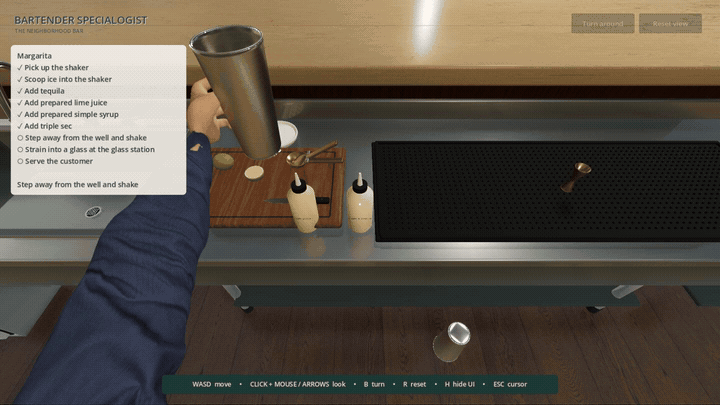

# Bartender Specialogist

A first-person neighborhood bar built with C# and Godot 4.7.2 .NET.

**Original work by [Navin Ratnayake (@navinrtnk)](https://github.com/navinrtnk).** Copyright © 2026 Navin Ratnayake.

Take a customer's order, collect your shaker, scoop ice, and add tequila, prepared lime juice, simple syrup, and triple sec. Seal and shake, strain into a glass, and serve. Jointed first-person hands handle the tools throughout.

The customer tastes the drink, says “Great drink!”, and takes casual sips over a minute as the glass empties. Collect the glass and load the dishwasher to repeat. Each drink makes him tipsier; after five he falls asleep on the bar. Clear up and start a new shift to continue.

Use **WASD** and mouse/arrows to move/look. Aim at highlighted objects and press **Space**. Take orders from the workstation; use the right-hand service gap to serve and collect glasses. Menus use **arrows + Space**; **Esc** closes them. **H** toggles hints. Touch devices have an Interact button.

## Run and test

Install **Godot 4.7.2 .NET** and **.NET 8**, open `project.godot`, build, and press **F5**. On Windows, `./scripts/run.ps1` launches the game; use `-Test`, `-Export`, or `-Compatibility` as needed. Extract the full Windows ZIP before running it.

Measurements are not simulated. Animation and speech are procedural/synthesized; this remains a visual prototype. See [test coverage](Tests/README.md) and [MIT license](LICENSE). External assets are credited in [third-party notices](THIRD_PARTY_NOTICES.md). Please link to this original project when sharing derivatives.
