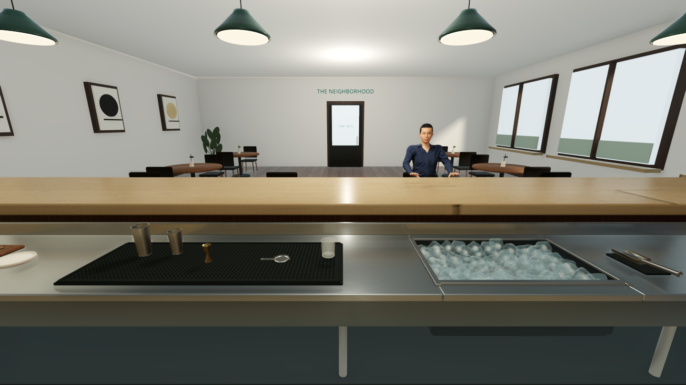

# Bartender Specialogist

An explorable first-person neighborhood bar, built with C# and Godot 4.7.2 .NET.

**Original creator and maintainer: [Navin Ratnayake (@navinrtnk)](https://github.com/navinrtnk).** This is the original Bartender Specialogist project. Copyright © 2026 Navin Ratnayake.

## Current setting

- A bright, modern bar with four tables, four bar stools, and a first-person bartender viewpoint.
- Two illuminated shelves with ten detailed bottles: two each for tequila, vodka, gin, whiskey, and rum. Shaped glass, liquid levels, ribbed closures, and original curved labels add detail up close.
- A clear customer counter and a separate, lower stainless bartender workstation, with supplies along the bartender's edge.
- A recessed ice basin with irregular melted cubes, refractive shells, cloudy interiors, and trapped air bubbles; a metal scoop rests in a separate dry cradle.
- Margarita tools, citrus prep, salt, and a speed rail. Details include brushed steel, rolled shaker rims, a perforated strainer with a coiled spring, cut glass, salt crystals, citrus pulp, and a woven towel.
- Scanned 4K wood, marble, plaster, and upholstery materials, brushed metal, interior reflections, ambient occlusion, and beveled edges.
- Glazed tile, cabinet joinery, upholstery piping, and spun pendant shades with brass trim.
- One seated customer with a connected anatomical neck, detailed hands, textured hair/brows/lashes, and fitted clothing with fabric folds, normal maps, and ambient occlusion.
- Movement within the bartender aisle, mouse/keyboard look, and touch movement/look controls.

Equipment and ingredients are scenery; drink preparation and customer interaction are not implemented. The environment combines original procedural geometry with CC0 material scans and customer assets. The current scene remains a visual prototype.

## Run

Install [Godot 4.7.2 .NET](https://godotengine.org/download/archive/4.7.2-stable/) and the [.NET 8 SDK](https://dotnet.microsoft.com/download/dotnet/8.0). The standard, non-.NET Godot editor cannot run the C# scripts.

Open `project.godot` in the .NET editor, build the C# project, and press **F5**. On Windows, `./scripts/run.ps1` also builds and launches the project when the tools are available.

Desktop rendering uses Forward+ with reflections, indirect lighting, and temporal anti-aliasing. On older graphics hardware, use `./scripts/run.ps1 -Compatibility` to launch the OpenGL renderer. Fullscreen uses the display's native resolution, including 3840 × 2160 on a 4K display.

For a Windows executable, install the matching Godot .NET Windows export templates and run `./scripts/run.ps1 -Export`. The version comes from `VERSION` (currently **1.0**). The command rebuilds, checks the scene, and creates `builds/1.0/windows/BartenderSpecialogist.exe` and `builds/BartenderSpecialogist-1.0-windows.zip`. Extract the full ZIP and keep the executable with its adjacent data folder. The export bundles the .NET runtime and runs without the editor or SDK.

| Control | Action |
| --- | --- |
| WASD | Move behind the bar |
| Click, then move mouse | Look around |
| Arrow keys | Look around without mouse capture |
| B / Turn around button | Turn toward the bottle shelves or seating |
| R / Reset view button | Return to the starting viewpoint |
| H | Toggle the interface |
| Esc | Release the mouse |
| F11 | Toggle fullscreen |
| Touch: drag left / right side | Move / look |

## License and attribution

The original code and procedural scene assets in this repository are available under the [MIT License](LICENSE). Reuse, modification, and commercial distribution are permitted under its terms, including preservation of the copyright and license notice in copies or substantial portions. Third-party textures and customer assets retain their CC0 terms; sources are listed in [Third-party notices](THIRD_PARTY_NOTICES.md).

Please link back to this original repository when sharing a derivative; that link is a request, not an additional MIT condition. Bottle brand names identify real-world spirits; their trademarks belong to their respective owners. No official logos, bottle artwork, or brand endorsements are included.
